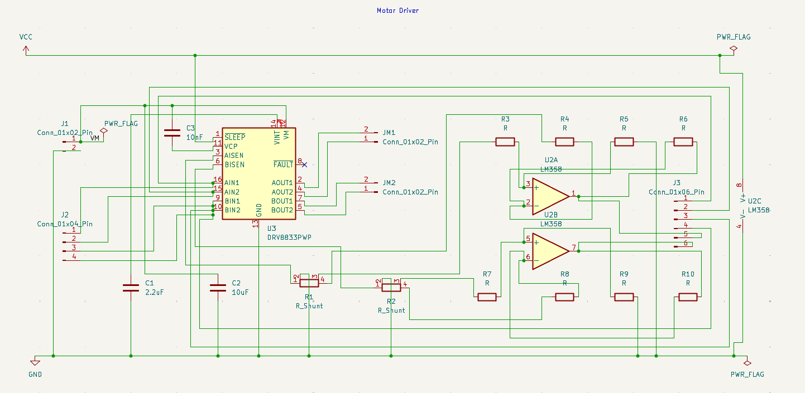
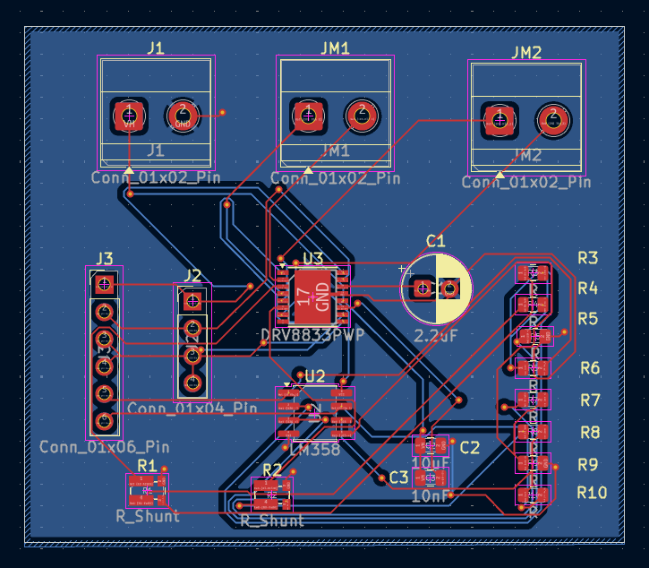
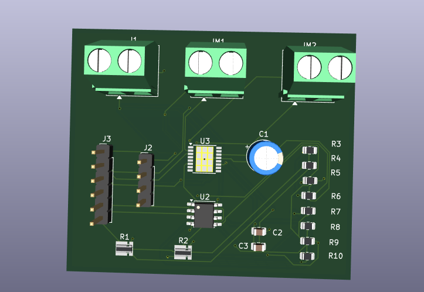

# Motor Driver PCB — DRV8833 Dual H-Bridge with Current Sensing

**Status:** The schematic and PCB layout are designed in KiCad, footprints are assigned, and Gerbers and drill files have been exported. The KiCad project, Gerbers and ERC/DRC reports are not uploaded yet. Bench testing hasn't been done. The current-sense figures below come from a model that uses placeholder resistor values (see [Results](#results)). None of them are measurements.

[](media/schematic.png)

[](media/layout.png)

[](media/3d.png)

## What This Is

A two-channel DC motor driver built around the TI DRV8833 dual H-bridge. Each bridge drives one brushed DC motor in either direction from two logic inputs. Each bridge's low side returns to ground through a Kelvin shunt resistor. One half of an LM358 dual op-amp is wired as a difference amplifier across each shunt, giving a ground-referenced voltage proportional to motor current that a microcontroller ADC can read.

## How the Circuit Works

| Block | Parts | Role |
| ----- | ----- | ---- |
| H-bridge driver | U3 (DRV8833PWP) | Two H-bridges. AIN1/AIN2 set the direction and PWM of AOUT1/AOUT2, and BIN1/BIN2 do the same for BOUT1/BOUT2. The thermal pad (pin 17) connects to GND through thermal vias. |
| Charge pump and regulator caps | C3 (10 nF), C1 (2.2 µF) | C3 on VCP for the high-side gate drive. C1 on VINT, the internal regulator output. |
| Bulk decoupling | C2 (10 µF) | Motor supply VM to GND. |
| Current sense shunts | R1, R2 (R_Shunt, 4-terminal) | Low-side sense resistors on AISEN and BISEN. The DRV8833 starts chopping (current limiting) when a sense pin reaches 200 mV. |
| Sense amplifiers | U2A, U2B (LM358), R3–R10 | One 4-resistor difference amplifier per shunt, Kelvin-connected so trace resistance stays out of the measurement. U2C is the shared supply unit, powered from VCC. |
| Motor outputs | JM1, JM2 (2-pin terminal blocks) | JM1 = AOUT1/AOUT2 (motor A), JM2 = BOUT1/BOUT2 (motor B). |
| Motor supply input | J1 (2-pin terminal block) | Pin 1 = VM, pin 2 = GND. |
| Logic inputs | J2 (1×4 header) | AIN1, AIN2, BIN1, BIN2. Confirm the pin order against the schematic. |
| Sense outputs and supply | J3 (1×6 header) | Amplifier outputs and supply connections. Pin map to be documented. |

**Inductive kickback:** the schematic has no discrete flyback diodes. Recirculation current flows through the body diodes of the DRV8833's internal MOSFETs, which the datasheet relies on for brushed DC motors.

**Layout:** two layers, with ground copper pours and wider traces on the motor-current paths (VM, the motor outputs and the shunt returns).

## Results

| Parameter | Value | Evidence or qualification |
| --------- | ----- | ------------------------- |
| Sense amplifier gain | Rf / Rin, pending | Resistor values are not labelled on the schematic |
| Current-sense scale factor | Gain × Rshunt (V/A), pending | Depends on the values above |
| DRV8833 chopping current | 200 mV / Rshunt, pending | Datasheet ISEN trip threshold |
| Measurable current range | (VCC − 1.5 V) / (gain × Rshunt), pending | The LM358 output can't swing to the positive rail |
| Motor supply range | 2.7–10.8 V | DRV8833 datasheet limit, not tested on this board |
| Output current per bridge | 1.5 A RMS, 2 A peak | DRV8833 datasheet (PWP package, adequate copper), not tested |
| ERC / DRC | pending | Checks run, reports not uploaded |
| Manufacturing package | exported, not uploaded | Gerbers and drill files to be added to `kicad/gerbers/` |
| Bench validation | pending | Not assembled |

The sense model in `simulation/` uses placeholder values: Rshunt = 0.1 Ω, Rin = 10 kΩ, Rf = 100 kΩ and VCC = 5 V. With those values the sense output is 1 V/A, chopping starts at 2 A, and the op-amp saturates at 3.5 A. The real numbers will change once the actual values are entered.

## Quick Start

**View the design:** *(pending upload)* Open the `.kicad_pro` file in the `kicad/` folder in KiCad, then open the schematic and PCB from the project manager.

**Run the current-sense model (Python):** From the repository root:

```bash
pip install numpy
python3 simulation/python/current_sense.py
```

**Run it in MATLAB:** Set the MATLAB working directory to the repository root and run `simulation/matlab/current_sense_model.m`. It prints the same table and plots output voltage against motor current.

Both scripts read every `.dat` file in `workdir/` (one motor current in amps per line) and use the parameter values at the top of each script. Update those values to match the schematic before using the output.

**SPICE:** `models/current_sense.cir` contains one sense channel (shunt plus difference amplifier) as an ngspice-style DC sweep, with a behavioural op-amp in place of the LM358.

## Bill of Materials

| Reference | Value | Package / specification | Selection status |
| --------- | ----- | ----------------------- | ---------------- |
| U3 | DRV8833PWP | TSSOP-16 with exposed pad, 4.4 × 5 mm, 0.65 mm pitch, thermal vias | Footprint assigned; part number to confirm |
| U2 | LM358 | SOIC-8, 3.9 × 4.9 mm, 1.27 mm pitch | Supply and output-swing check pending |
| R1, R2 | R_Shunt | Vishay WSKW0612, 4-terminal (Kelvin) | Resistance, power rating and part number pending |
| R3–R10 | R | 0805 SMD | Values and tolerance pending (matching sets the amplifier's CMRR) |
| C1 | 2.2 µF | Radial, 6.3 mm diameter, 2.5 mm pitch; **polarised** | Voltage rating and part number pending. The datasheet recommends a ceramic capacitor on VINT. |
| C2 | 10 µF | 0805 SMD | Must be rated above the maximum VM; part number pending |
| C3 | 10 nF | 0805 SMD | Voltage rating and part number pending |
| J1, JM1, JM2 | 2-pin terminal block | Phoenix MKDS 1,5-2, 5.08 mm pitch | Manufacturer part number pending |
| J2 | 1×4 header | 2.54 mm pitch, vertical | Manufacturer part number pending |
| J3 | 1×6 header | 2.54 mm pitch, vertical | Manufacturer part number pending |

## Project Files

| Path | Contents |
| ---- | -------- |
| `kicad/` | Project, schematic, PCB and manufacturing files (to be added) |
| `simulation/` | Current-sense models in Python and MATLAB |
| `models/` | SPICE netlist for one sense channel |
| `workdir/` | Motor-current sweep inputs for the simulation scripts |
| `media/` | Schematic, layout and 3D render images |

## Limitations and Next Steps

- Upload the KiCad project, Gerbers, drill files and ERC/DRC reports.
- Label R1–R10 with values in the schematic and update the simulation parameters to match.
- Connect nFAULT (pin 8, currently unconnected) to J3 so a microcontroller can detect over-current, over-temperature and undervoltage faults.
- Confirm the nSLEEP connection, then document the J2 and J3 pin maps.
- Size the shunt power rating for the worst-case motor current (I² × Rshunt).
- Assemble the board, run a motor under load, and compare the measured sense voltage with the model before claiming physical validation.

## Tools and Attribution

- KiCad: schematic and PCB design (record the exact version from the project files).
- TI DRV8833 datasheet: pin functions, external component values, the ISEN current-chopping threshold and output ratings.
- LM358 datasheet: input common-mode range (includes ground) and output swing limits.

## License

MIT License. See [LICENSE](LICENSE).
